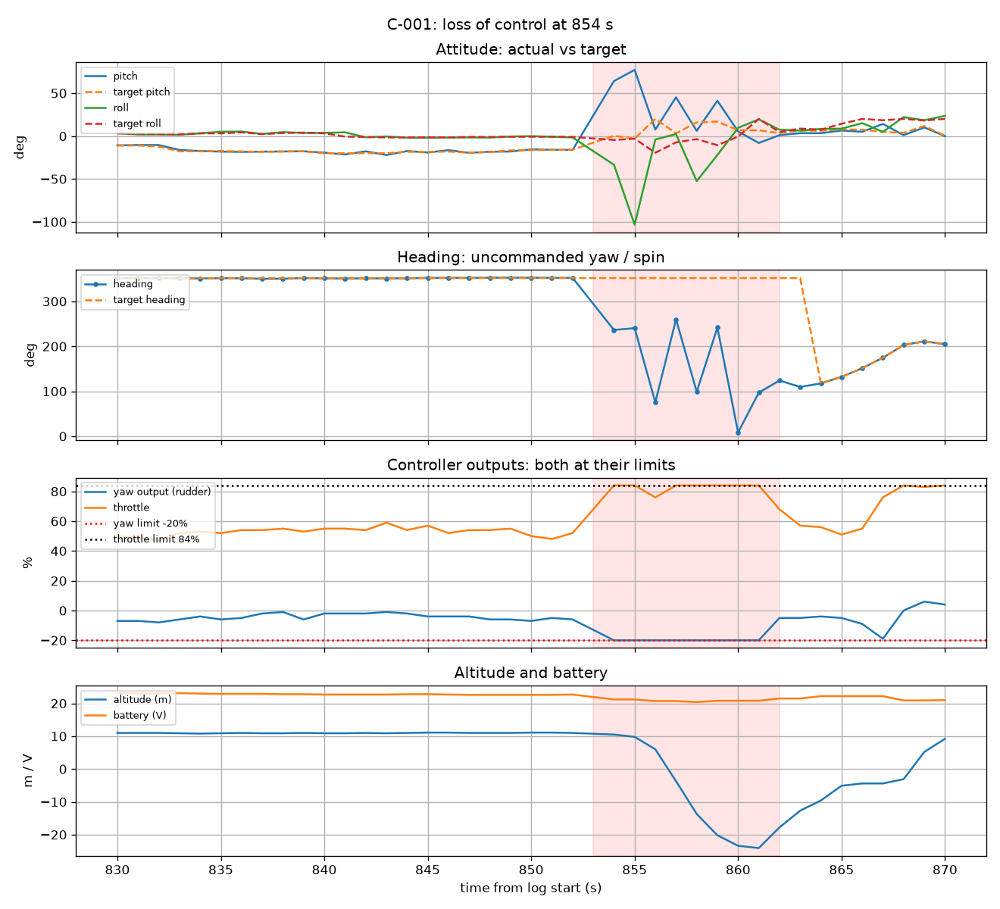

# C-001: Multirotor upset at 854 s

**Interactive report:** https://jamaltarakzai.github.io/uav-integration-portfolio/c001/

Flight log analysis of a multirotor that suddenly spun, rolled inverted and lost
about 35 m of height in steady forward flight, then recovered after 8 s.

## Finding

The yaw was **uncommanded**: target heading stayed at 352° while the aircraft
turned 116° in 2 s and kept spinning. The controller drove yaw output to its
−20% limit and throttle to its 84% limit together for 8 s and still could not
hold attitude.

Battery, GPS, radio link, flight mode and the attitude sensor were all normal
before and during the event. The most likely cause is a **sudden, temporary
loss of thrust on one motor, propeller or ESC**.

## Timeline

| Time | Event |
|---|---|
| 0–420 s | On the ground, motors off |
| ~436 s | Take-off, hover at ~49% throttle |
| ~840 s | Forward flight, 12–15 m/s at ~11 m |
| 854 s | Uncommanded yaw 116° in 2 s, roll −103° (inverted) |
| 854–861 s | Yaw output and throttle pinned at their limits; height −35 m |
| 862–870 s | Recovery and climb; log ends in flight |

## Ruled out

| Suspect | Evidence |
|---|---|
| Battery | 3.78 V/cell before the event; sag followed throttle and recovered |
| GPS | 28 satellites, 1 m accuracy before the event |
| Radio link / failsafe | RC update rate steady at 66–67 Hz; flight mode never changed |
| Sensor / controller | INS update steady at 200 Hz; error word 0 throughout |

## Evidence for motor / propeller / ESC

- Target heading held while the aircraft spun: no pilot or controller command.
- Yaw output and throttle at their limits at the same time: no control authority left.
- Yaw output sat at −5 to −7% through normal hover and cruise: an existing imbalance
  (weak, tilted or damaged motor or propeller) before the event.
- Recovery after 8 s: the loss was temporary (e.g. ESC desync, loose propeller,
  intermittent connection), not a fully failed motor.

## Recommended checks

- Propellers: cracks, looseness, correct type and direction.
- Motors: spin by hand (power off) for roughness; check mounting and tilt.
- ESCs and wiring: solder joints, connectors, heat marks.
- Next aircraft: hover test and confirm yaw output stays near 0%.

## Method

1. Built a time axis from the GNSS clock and removed 6 duplicated rows
   (time going backwards at the end of the log).
2. Read the flight at 1-minute resolution to find the flight phases, then the
   last 30 s second by second.
3. Checked each suspect (battery, GPS, RC link, mode, INS) against the event time:
   cause comes before the upset, effect comes after.
4. Compared actual vs target for pitch, roll and heading, and controller outputs
   against their limits.

## Files

| File | Purpose |
|---|---|
| `analysis.py` | Cleaning and step-by-step tables (pandas) |
| `interactive.py` | Builds the interactive report page (plotly) |
| `event.png` | Static event graph (matplotlib) |
| `../../docs/c001/index.html` | Published interactive report |

## Limitations

- Telemetry is 1 Hz; one record (853 s) is missing.
- No per-motor RPM in the log, so the specific motor cannot be identified from data.
- Alarm code 36 could not be decoded without vendor documentation.
- Findings should be confirmed by physical inspection.

The raw log is private and not included in this repository; it contains no data
that identifies the operator or location in the published files.
